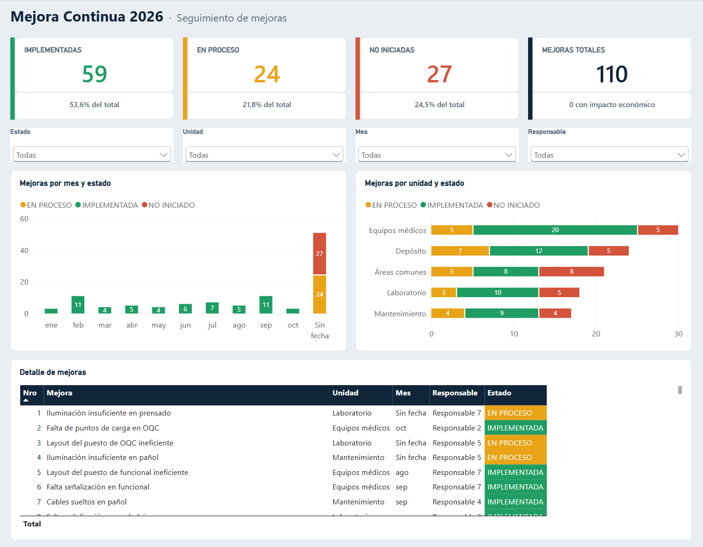

# 📈 Continuous Improvement 2026

> One-page dashboard to follow the year's **continuous improvement initiatives**: how many there are, what state they are in, who owns them and which ones have an economic impact.

*The report itself (page names, measures, labels) is in Spanish.*

> 📸 The screenshot uses **synthetic demo data** (generic sites, units and owners) generated with [`demo/generate_demo_data.py`](demo/generate_demo_data.py).

## 📌 Questions it answers

- How many improvements are registered, and what share is **implemented**, **in progress** or **not started**?
- How do implementations evolve **month by month**?
- Which sites, units and workstations concentrate the improvements?
- How many initiatives have an **economic impact**?

## 🧱 Data model

A single `Mejoras` table loaded from the tracking Excel file through the `RutaExcel` parameter. Power Query skips the title row, cleans column names, fixes types and derives the month from the implementation date.

Columns: number, improvement, action, implementation date, site, unit, workstation, IDOC status, status, owner, economic impact, month.

## 📐 Measures

| Measure | What it measures |
|---|---|
| Mejoras totales | Number of initiatives |
| Implementadas / En proceso / No iniciadas | Count per status |
| % Implementadas / % En proceso / % No iniciadas | Share of each status |
| Con impacto económico | Initiatives with a reported saving or benefit |
| Texto … / Color Estado | Dynamic text and conditional formatting |

## ▶️ How to open it

1. Use the included `demo/mejora_continua_demo.xlsx`, or create a new one with `pip install openpyxl` and `python demo/generate_demo_data.py`.
2. Open `Mejora Continua 2026.pbip` in Power BI Desktop.
3. Under **Transform data → Parameters**, point `RutaExcel` to that file.
4. Refresh.
